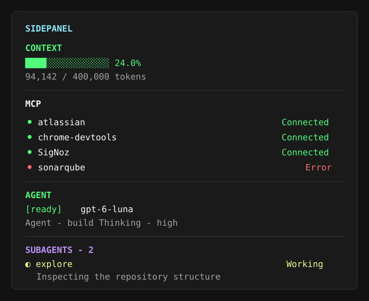

# OpenCode Sidepanel

A plugin-owned sidebar for **OpenCode V2**. It replaces OpenCode's native sidebar and composes the widgets selected by the plugin:

- live context-window usage
- MCP connection status
- agent and activity state
- workspace and usage details
- durable subagent history with working/finished/failed states



## Install

### npm / npx (recommended)

After the package is published to npm, install it with one command:

```sh
npx opencode-sidepanel@latest install
```

The command adds the versioned npm package to `~/.config/opencode/cli.json`. OpenCode then downloads and loads it through its normal CLI plugin resolver. No Git clone, Bun installation, or build step is required for users.

Restart OpenCode TUI windows after installation.

To remove it, delete the `opencode-sidepanel@...` entry from the `plugins` array in `~/.config/opencode/cli.json`.

### Alternative: standalone installer

The repository also includes a prebuilt shell installer for environments where npm is unavailable:

```sh
./install.sh
```

When this repository is hosted, it can be run directly with:

```sh
curl -fsSL https://raw.githubusercontent.com/adhadse/opencode-sidepanel/main/install.sh | sh
```

## Develop and publish

Requirements: Bun 1.3 or newer and an npm account with permission to publish the configured package name.

```sh
bun install
bun run typecheck
bun run build
npm publish
```

`bun run build` compiles `dist/tui.js` and refreshes the standalone installer bundle. `npm pack --dry-run` is useful for checking the published contents before release.

This package exposes a `./tui` entrypoint, which is the standard OpenCode V2 CLI-plugin convention. Users can also add `"opencode-sidepanel"` directly to the `plugins` array in `cli.json` if they prefer manual configuration.

## Configure from the UI

Sidepanel owns the `sidebar.content` slot, so native sidebar widgets are replaced by the Sidepanel widgets. No OpenCode config-file edits are needed to change the layout.

Open the settings dialog with:

- `/sidepanel-settings`
- `/sidepanel-config` (alias)
- Command palette: **Configure Sidepanel widgets**

Select any widget to toggle it between shown and hidden. Settings are persisted per user and synchronized across OpenCode TUI windows.

Available widgets:

- Context
- MCP servers
- Agent
- Activity
- Workspace
- Usage
- Subagents

## Commands

- `F6` or `/sidepanel`: open the Sidepanel as a session panel
- `/sidepanel-settings`: show or hide widgets from the UI
- `/all-sessions`: find sessions across all locations

## License

MIT. See [LICENSE](LICENSE).
